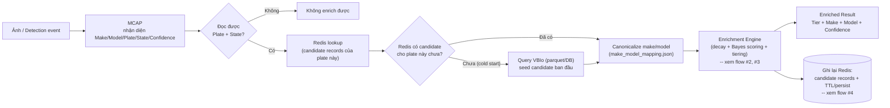
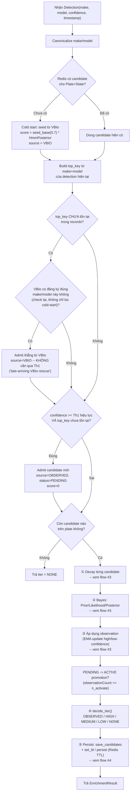
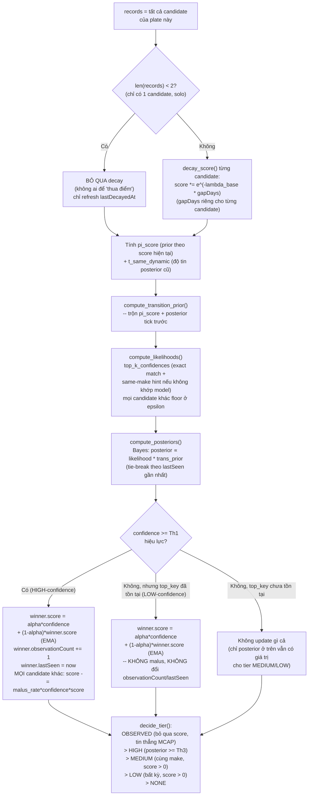
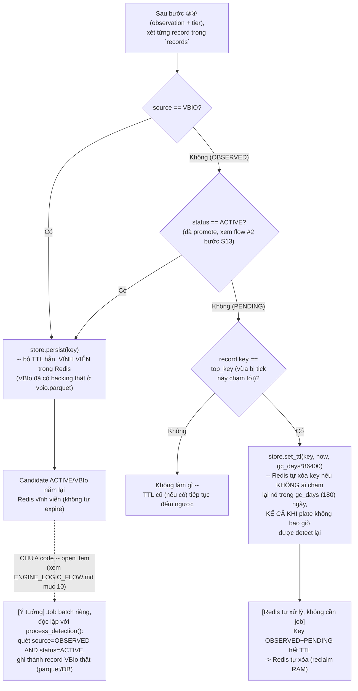

# Flowchart tổng hợp — Enrichment Engine (Phase 2)

> Tài liệu này chỉ tập trung vào 4 flowchart, ở các mức zoom khác nhau, để dễ trình bày/report.
> Chi tiết đầy đủ (công thức, tham số, lịch sử các fix, case study thật) nằm ở
> `ENGINE_LOGIC_FLOW.md` — tài liệu này chỉ tóm lại dưới dạng hình vẽ + giải thích ngắn.

---

## 1. Flow tổng thể (high-level)

Góc nhìn toàn cảnh: từ 1 frame ảnh MCAP đến kết quả enrich cuối cùng, không đi vào chi
tiết công thức.

**Đọc nhanh:**
- Mỗi "tick" = 1 detection cho 1 (plate, state).
- "Redis lookup" không đơn thuần là đọc — nếu Redis trống hẳn (plate chưa từng thấy), engine seed thẳng từ VBIo (DMV source of truth).
- Canonicalize chạy **trước** khi vào engine tính điểm, để VBIo và MCAP không bị lệch chính tả (vd "Hyundai" vs "Huyndai") tạo ra 2 candidate khác nhau cho cùng 1 xe.
- Việc ghi lại Redis ở cuối **không chỉ là lưu record** — còn kèm set/refresh TTL (xem flow #4).

---

## 2. Flow logic Enrichment (`EnrichmentEngine.process_detection()`)

Zoom vào đúng 1 lần gọi `process_detection()` — thứ tự các bước quyết định candidate nào
được admit, candidate nào được update, và admit bằng con đường nào (MCAP tự đạt ngưỡng,
hay VBIo xác nhận thẳng).

**"Th1 hiệu lực"** không phải hằng số cố định: dùng `th1` (0.90) nếu plate **đã từng** có
candidate `source=VBIO`; dùng `th1_no_vbio` (0.80, thấp hơn) nếu plate **chưa từng** có
VBIo backing — tránh trường hợp 1 xe đúng, đọc lặp lại nhất quán ở confidence trung bình
(0.54-0.80) không bao giờ được tin, trong khi 1 lần đọc sai (platform dễ nhầm) vừa đủ
vượt 0.90 lại được tin ngay.

---

## 3. Flow cơ chế tính điểm (Redis scoring mechanism — Bayes/HMM + EMA)

Zoom vào bên trong bước ①②③ ở flow #2 — đây là "trái tim" toán học: decay, Bayes
posterior, và cách `score` của mỗi candidate được cập nhật.

**Vì sao EMA, không phải `score += confidence`:** cộng dồn không có chặn trên — 1 plate bị
detect nhiều sẽ có `score` tăng vô hạn, vượt ngân sách field 16-bit (0.00-655.35) RFC-01
cấp cho `CredibilityScore`. EMA (`score = alpha*confidence + (1-alpha)*score`) tự nhiên bị
chặn trong khoảng gần [0,1] vì là trung bình có trọng số của 2 giá trị đều trong [0,1].

---

## 4. Flow Redis ↔ VBIo (Periodical sync / TTL lifecycle)

Zoom vào bước ⑤ (persist) ở flow #2 — cách Redis tự dọn rác và cách 1 candidate "được
công nhận" lâu dài. Lưu ý rõ phần nào **đã code**, phần nào **chưa** (open item).

**Đã implement (production-ready):**
- `set_ttl`/`persist` ở tầng storage (`vbio/clients/redis_store.py`) — map thẳng ra lệnh
  Redis `EXPIRE`/`PERSIST` thật, không cần job quét nào cả.
- Promotion PENDING→ACTIVE (`cleanup.maybe_promote()`) dựa trên `observationCount >= n_activate`.
- Test trên 97-profile: accuracy 96.74% (so với 96.07% nếu không có TTL/promotion) — xem
  `ENGINE_LOGIC_FLOW.md` mục 9 cho toàn bộ lịch sử (kể cả 1 bản thiết kế cũ — scan thủ công
  mỗi tick — đã bị bỏ vì không dọn được rác của plate "chết hẳn").

**CHƯA implement (open item, nhánh chấm-chấm trong hình):**
- Việc đưa 1 candidate `OBSERVED+ACTIVE` (đã "mồ côi" vĩnh viễn trong Redis) thành 1 record
  VBIo thật — hiện tại nó chỉ nằm lại Redis mãi mãi, không tự động đồng bộ ra `vbio.parquet`/DB.
  Cần 1 job batch độc lập, hoàn toàn tách khỏi hot path `process_detection()`.
