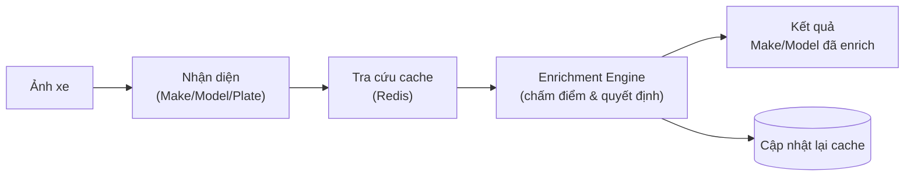
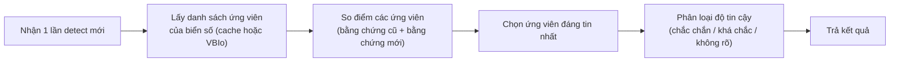
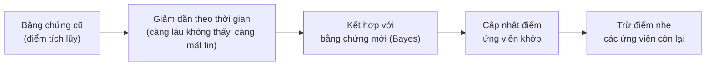
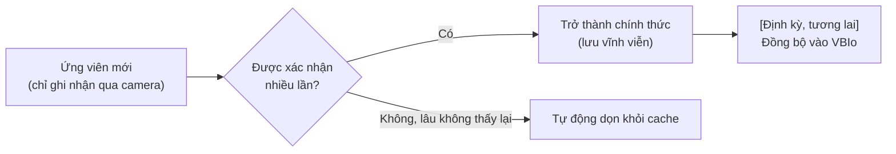

# Flowchart high-level — dùng cho slide report

> Bản rút gọn của `ENGINE_FLOWCHARTS.md` (giữ nguyên để trace/debug) — chỉ còn khối
> concept chính, không có tên field/function/tham số, phù hợp đưa vào slide.

---

## 1. Flow tổng thể

---

## 2. Flow logic Enrichment

---

## 3. Flow cơ chế tính điểm (Redis scoring)

---

## 4. Flow đồng bộ định kỳ Redis ↔ VBIo

