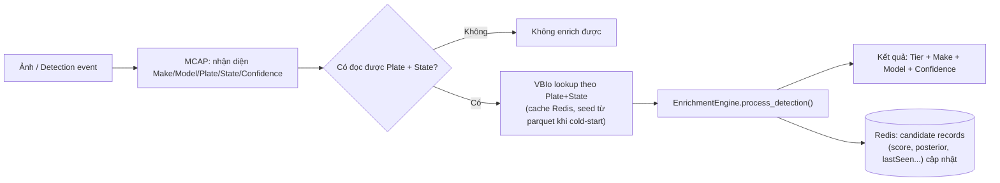
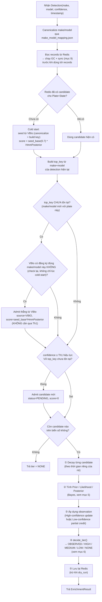
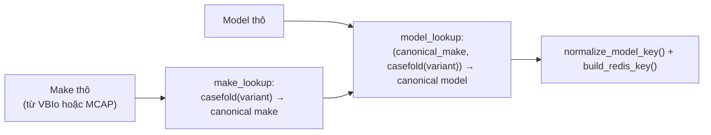
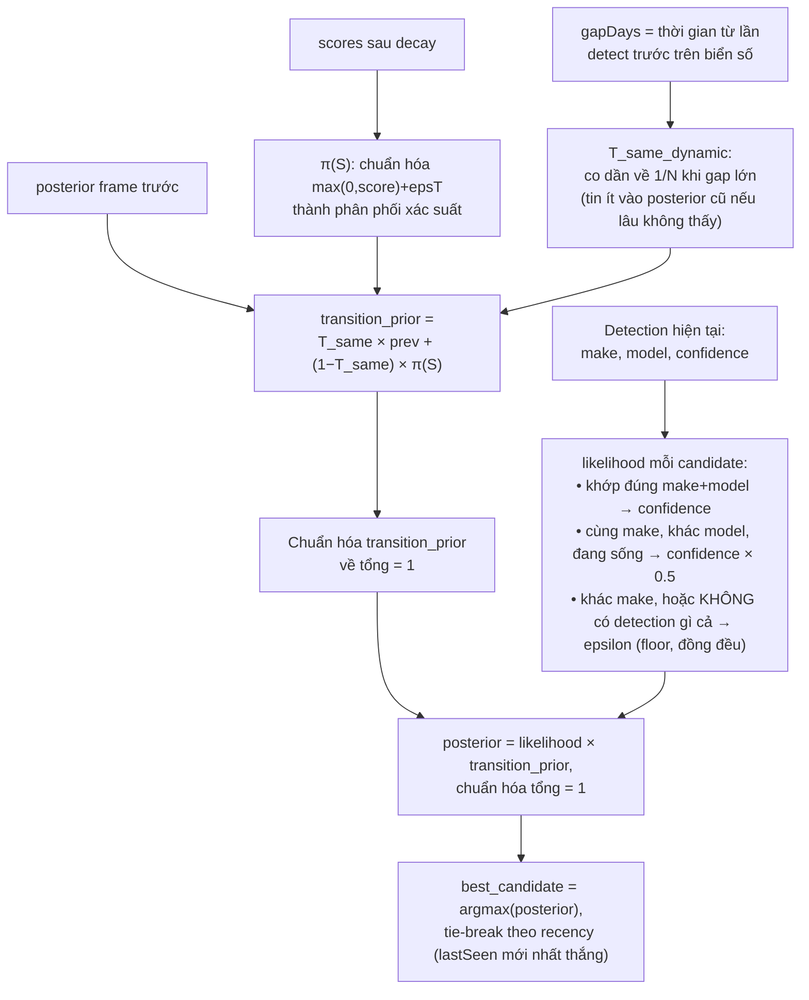
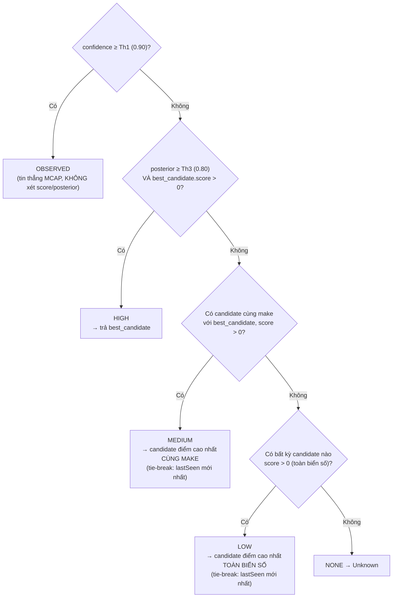
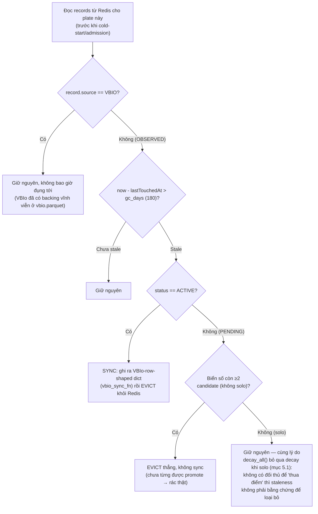

# Cơ chế vận hành của Enrichment Engine (Phase 2) — để viết report & reproduce production

> Tài liệu này mô tả logic hiện tại trong `vbio/enrichment/` (đã áp dụng các fix: chuẩn hóa
> key qua `make_model_mapping.json`, tie-break theo recency, Bayes same-make likelihood hint).
> Mục tiêu: đủ chi tiết để viết report và để một người khác code lại đúng thuật toán trên
> production mà không cần đọc source code.

> **Engine có 2 trách nhiệm tách biệt, đóng trong 2 nhóm module khác nhau:**
> 1. **Enrich / tính điểm** (mục 1-8 dưới đây) — `engine.py` + `posterior.py` + `scoring.py`
>    + `tiering.py`: với 1 detection, candidate nào là xe thật của biển số này ngay bây giờ?
> 2. **Dọn rác (cleanup)** (mục 9) — `cleanup.py`: candidate nào trong Redis còn đáng giữ,
>    candidate nào nên bị dọn, và candidate nào đã "đủ chín" để trở thành vĩnh viễn?
>
> 2 nhóm này chạy NỐI TIẾP trong CÙNG 1 lần gọi `process_detection()` (dọn rác chạy trước,
> ngay khi vừa đọc `records` từ Redis) nhưng là 2 bộ luật hoàn toàn độc lập — xem mục 9.

## 1. Bức tranh tổng thể (end-to-end pipeline)



- **Input** cho mỗi lần "tick": 1 `Detection` = `(plate_number, plate_state, make, model, confidence, timestamp, top_k_confidences?)`.
- **Output**: 1 `EnrichmentResult` = `(tier, make, model, confidence, candidates[])`, với `tier ∈ {OBSERVED, HIGH, MEDIUM, LOW, NONE}`.
- Mỗi biển số (`plate_number + plate_state`) có thể có **nhiều candidate** (nhiều cặp Make/Model khác nhau từng được ghi nhận) — mỗi candidate là 1 Redis hash riêng, key dạng:
  `vbio:{PLATE}:{STATE}:{make}_{model}` (đã chuẩn hóa case/khoảng trắng/dấu câu).

## 2. Cấu trúc 1 candidate record

| Field | Ý nghĩa |
|---|---|
| `key` | Redis key, plate-scoped: `vbio:{PLATE}:{STATE}:{make_model}` |
| `make`, `model` | Đã canonicalize qua `make_model_mapping.json` (xem mục 4) |
| `score` | Điểm tích lũy (credibility), decay theo thời gian |
| `posterior` | Xác suất Bayes của candidate này tại lần detect gần nhất |
| `lastDecayedAt` | Mốc thời gian lần cuối `score` được decay — **riêng cho từng candidate** |
| `lastSeen` | Lần cuối candidate này thực sự được xác nhận MẠNH (VBIo LastSeen, hoặc lần detect high-confidence gần nhất) — **không** đổi khi chỉ có detect low-confidence |
| `lastTouchedAt` | **(mới, mục 9)** Lần cuối candidate này được bất kỳ detection nào (mạnh HOẶC yếu) chạm tới — field riêng dùng cho TTL cleanup, khác `lastSeen` ở trên |
| `firstSeen` | Lần đầu biết đến candidate này |
| `observationCount` | Số lần được xác nhận bằng detection confidence cao |
| `status` | `PENDING` (mới, chưa đủ bằng chứng) hoặc `ACTIVE` (đã được promote — xem mục 9; với `source=VBIO` luôn coi là permanent bất kể giá trị field này) |
| `source` | `VBIO` (seed từ parquet) hoặc `OBSERVED` (candidate mới phát hiện) |

## 3. Luồng xử lý 1 detection — `EnrichmentEngine.process_detection()`



**"Th1 hiệu lực" (effective Th1) — fix #7, xem mục 8:** không phải hằng số cố định 0.90.
```
effective_th1 = th1 (0.90)         nếu plate ĐÃ TỪNG có candidate source=VBIO
effective_th1 = th1_no_vbio (0.80) nếu plate CHƯA TỪNG có candidate source=VBIO
```
Kiểm tra `any(r["source"]=="VBIO" for r in records)` — miễn phí, không cần lưu trữ
thêm (records đã load sẵn trong tick này). Lý do: 1 biển số **chưa từng** có đăng ký
DMV không có gì để "neo" vào trong lúc chờ 1 lần đọc đạt 0.90 — case thật
(`CHC673_OK`): make/model đúng (Nissan Sentra) xuất hiện lặp lại nhất quán ở
confidence 0.54–0.80 nhưng **không bao giờ chạm 0.90**, nên không được admit, trong
khi 2 lần đọc SAI (platform dễ nhầm, 1 lần duy nhất) lại đạt 0.94/0.95 và được tin
ngay. Hạ `Th1` cho đúng case "0 VBIo backing" giúp candidate đúng có cơ hội được admit
sớm hơn — **không đổi `Th1=0.90` cho các plate đã có VBIo** (không mở rộng rủi ro
issue #1 cho case đã có DMV backing).

**"Late-arriving VBIo rescue" — fix #8, xem mục 8:** `th1_no_vbio` (fix #7) chỉ giúp
được khi plate **chưa từng** có VBIo nào. Nhưng có 1 case khác: plate **đã có** VBIo
(xe cũ) → `th1_no_vbio` không áp dụng, vẫn dùng Th1=0.90 đầy đủ — nhưng xe **MỚI**
(sau khi chuyển chủ/đổi xe) tuy **đã có trong VBIo**, lại không được seed vì cold-start
chỉ chạy **đúng 1 lần** (ở detection đầu tiên của cả profile — nếu registration của
xe mới có `LastSeen` SAU thời điểm đó, nó bị lọc bỏ lúc cold-start và **không bao giờ
được xét lại**). Case thật (`HMU4444_NY`): xe chuyển từ Mazda CX-9 sang Nissan Rogue,
Rogue đã đăng ký VBIo từ 2025-01-01, nhưng vì cold-start của profile này chạy từ
2023-04-03 (trước khi Rogue đăng ký), Rogue không được seed — MCAP phải tự đạt Th1=0.90
mới admit được Rogue, mất **~8 tháng** (từ lần đọc 0.62 đầu tiên tới lần đọc 0.98).

**Fix:** khi detection có `(make, model)` **chưa khớp candidate nào đang có**, kiểm
tra lại VBIo riêng cho đúng `(make, model)` đó (không seed lại toàn bộ) — nếu VBIo
xác nhận hợp lệ tính đến `now`, admit **thẳng** với `source=VBIO`,
`score=seed_base*HmmPosterior` — **không cần MCAP đạt Th1**, vì đây là sự thật DMV,
không phải suy đoán từ hình ảnh. Chỉ gọi `vbio_seed_fn` thêm khi gặp 1 `(make,model)`
**hoàn toàn mới** (hiếm, không phải mỗi tick) — một khi đã admit, không cần check lại.

Test trên 97 profile: **+43 record** (7 profile cải thiện, `HMU4444_NY` admit đúng
ngay khi Rogue "hợp lệ" thay vì chờ 8 tháng). **1 regression nhỏ** (`GRS1894_PA`,
-1): plate có 2 candidate VBIo cùng năm đăng ký (Subaru Legacy + Outback) — 1 lần đọc
yếu của candidate "anh em" đủ để nó leapfrog tạm thời nhờ điểm seed mạnh. Net tích
cực, đã chấp nhận đánh đổi này.

## 4. Chuẩn hóa tên (Make/Model alias canonicalization)

**Vấn đề gốc:** VBIo (DMV) và MCAP có thể dùng chính tả khác nhau cho CÙNG một xe
(ví dụ "Hyundai" vs "Huyndai", "Tlx" vs "Tl"). Nếu không gộp lại, mỗi chính tả tạo
thành 1 candidate riêng → chia nhỏ bằng chứng, khiến candidate đúng thua điểm so với
1 candidate sai nhưng được viết nhất quán.



- Nguồn dữ liệu: `assets/make_model_mapping.json` (do người review, có field `canonical` + `variants`).
- **Lưu ý quan trọng:** đây là quyết định *do con người curate*, không phải thuật toán tự suy ra.
  Ví dụ: "Supra" và "GR Supra" (Toyota) được curator **cố ý giữ là 2 model khác nhau**
  (`reviewed: true`, không có `suggestedMerge`) — code **không tự ý gộp** 2 cái này.
- Việc canonicalize được áp dụng ở **mọi nơi** build key: seed từ VBIo, detection từ MCAP, và
  entry trong `top_k_confidences`.

## 5. Bước ② — Prior / Likelihood / Posterior (Bayes)

### 5.1. Decay (bước ①, trước Bayes)

Mỗi candidate tự decay theo thời gian riêng (KHÔNG theo đồng hồ chung của biển số):

```
score = score × e^(−λ × Δt_ngày)
λ = 0.00385   (half-life ≈ 180 ngày)
Δt_ngày = (now − lastDecayedAt_của_candidate_này)
```

**Ngoại lệ — biển số chỉ có ĐÚNG 1 candidate:** decay bị **bỏ qua hoàn toàn** (chỉ
`lastDecayedAt` được refresh, `score` giữ nguyên). Lý do: decay tồn tại để 1 candidate
"thua" dần so với candidate khác có bằng chứng mới hơn — nếu không có ai để so sánh,
decay không phục vụ mục đích gì, chỉ làm candidate (dù đúng) mất dần tín nhiệm một cách
vô nghĩa. Xem mục 8, fix #5, để biết tại sao đây là vấn đề nghiêm trọng: nếu MCAP
**chưa từng được train** để nhận ra 1 make/model, candidate VBIo tương ứng (seed=0.63)
decay xuống dưới `eps_t` (0.05, mục 5.2) chỉ sau **~658 ngày (~1.8 năm)** — từ đó coi như
"biến mất" khỏi mọi so sánh Bayes, dù đúng 100% — và sẽ KHÔNG BAO GIỜ được MCAP xác
nhận lại để hồi phục, vì engine chưa từng train nhận diện nó. Ngay khi có candidate
thứ 2 thật xuất hiện (bất kể đúng/sai), decay resume bình thường cho mọi candidate.

### 5.2. Prior/Likelihood/Posterior



**Luôn chạy Bayes đầy đủ — không có nhánh fallback "chỉ nhìn score thô" nữa (fix #2,
mục 8):** khi KHÔNG có detection nào cả (MCAP trả Unknown), mọi candidate nhận
likelihood = epsilon **đồng đều** → likelihood trở thành "no-op" → posterior tự động
**quy về đúng `trans_p`** (có trí nhớ, đã trộn lịch sử) — không còn tình trạng "quên
lịch sử, chỉ so điểm hiện tại" như bản cũ.

**"Same-make likelihood hint" (bổ sung so với spec gốc, không có trong RFC-01 literal):**
khi MCAP báo 1 make khớp với 1 candidate đang sống nhưng model không khớp chính xác
(ví dụ MCAP nói "Toyota Supra", chỉ có "Toyota GR86"/"Toyota GR Supra" đang sống),
candidate đó vẫn được coi là có bằng chứng (`confidence × same_make_likelihood_weight`,
mặc định **0.5**) — thay vì bị bỏ qua hoàn toàn. Đây **chỉ ảnh hưởng `posterior`/tier
output của frame này, KHÔNG ghi đè `score`** (score vẫn chỉ đổi khi match chính xác, đúng
theo ví dụ slide CR-V/Pilot trong VRDB Plan).

### 5.3. Cập nhật `score` (bước ③ — khác với bước ② ở trên!)

Chỉ áp dụng khi khớp **chính xác** (make, model) với 1 candidate. **Công thức winner là
EMA (exponential moving average), KHÔNG phải cộng dồn không giới hạn:**

```
Nếu confidence ≥ Th1 (0.90):                         # "High-confidence"
    winner.score = α × confidence + (1-α) × winner.score     # EMA, bị chặn tự nhiên trong ~[0,1]
    winner.observationCount += 1
    mọi candidate khác trên biển số:
        score -= malus_rate(0.10) × confidence × max(0, score)   # malus (không đổi)

Nếu confidence < Th1 NHƯNG candidate đã tồn tại:      # "Low-confidence rescue"
    winner.score = α × confidence + (1-α) × winner.score     # CÙNG công thức EMA, không có
                                                               # hệ số giảm thang riêng (confidence
                                                               # thấp đã tự kéo ít hơn)
    (không ai bị trừ — tránh ảnh nhiễu/đêm phá điểm xe khác)
```

**Vì sao đổi từ cộng-dồn (`+= confidence`) sang EMA?** Công thức cộng dồn cũ **không có
chặn trên** — 1 biển số bị detect thường xuyên có thể đạt trạng thái ổn định
`score ≈ (số detect/ngày × confidence TB) / λ`, dễ dàng vượt quá **655.35** — giới hạn
của field 16-bit mà RFC-01 tự thiết kế cho `CredibilityScore` (fixed-point ×100), và
vượt quá range `0.0–100.0` mà `vbio_schema.py` tự document. EMA tự nhiên bị chặn trong
khoảng `[0,1]` (trung bình có trọng số giữa 1 score cũ và 1 confidence ∈[0,1] không thể
vượt quá giá trị lớn hơn trong 2 số đó) — không cần cap/clamp thủ công, và đã được kiểm
chứng **KHÔNG làm giảm accuracy** (thực tế còn cải thiện nhẹ) qua sweep trên 97-profile
test set — xem mục 8, fix #4, và `scripts/tune_score_params.py`.

**`seed_base` giảm từ 2.0 → 0.7** vì dưới EMA, 1 detection thật (confidence ≤ 1) không
thể vượt quá ~1.0 — seed cũ (2.0 × HmmPosterior ≈ 1.8) sẽ áp đảo vĩnh viễn mọi detection
thật nếu không hạ xuống cùng thang.

## 6. Bước ④ — `decide_tier()`: quyết định output cuối cùng



**Lưu ý quan trọng (issue đang mở, chưa fix — "issue #1"):** nhánh `OBSERVED` **bỏ qua
hoàn toàn** điểm số/lịch sử — dù 1 candidate khác đang dẫn điểm rất xa, 1 frame confidence
≥ 0.90 vẫn thắng ngay. Đây đúng theo RFC-01 literal, nhưng gây lỗi trong case
model/platform dễ nhầm (ví dụ GR86 ↔ BRZ) khi MCAP tự tin nhưng sai nhiều lần liên tiếp.
**Chưa fix trong code này.**

## 7. Bảng tham số (config hiện tại)

| Tham số | Giá trị | Ý nghĩa |
|---|---|---|
| `lambda_base` (λ) | 0.00385 | Tốc độ decay, half-life ≈ 180 ngày |
| `t_same_base` | 0.999 | Độ tin vào posterior cũ khi gap≈0 |
| `epsilon` | 0.010 | Floor cho likelihood, seed posterior |
| `th1` (Th1) | 0.90 | Ngưỡng "direct observation" — dùng khi plate ĐÃ có candidate `source=VBIO` |
| `th1_no_vbio` | **0.80** | Ngưỡng dùng thay `th1` khi plate CHƯA TỪNG có candidate `source=VBIO` — xem mục 3, fix #7 |
| `th3` (Th3) | 0.80 | Ngưỡng tier HIGH |
| `eps_t` | 0.05 | Floor cộng vào score khi tính π(S) |
| `malus_rate` | 0.10 | Tỷ lệ trừ điểm đối thủ (áp dụng cho mọi nhánh update winner) |
| `alpha` (α) | **0.3** | Trọng số EMA cho evidence mới: `score = α·confidence + (1-α)·score` (thay thế cách cộng dồn không giới hạn cũ) |
| `seed_base` | **0.7** | Điểm khởi tạo khi admit candidate từ VBIo (× HmmPosterior) — hạ từ 2.0 để khớp thang EMA |
| `same_make_likelihood_weight` | 0.5 | Hệ số likelihood cho candidate cùng make, khác model (bổ sung, không thuộc RFC-01 gốc) |
| `gc_days` | **180.0** | Số ngày `OBSERVED` candidate không được chạm tới (`lastTouchedAt`) trước khi bị coi stale — xem mục 9, fix #9 |
| `n_activate` | **3** | Số lần xác nhận high-confidence để `OBSERVED` candidate được promote PENDING→ACTIVE (miễn trừ TTL) — xem mục 9, fix #9 |

> `alpha`/`seed_base` được tune bằng `scripts/tune_score_params.py` trên tập test 97
> profile hiện có (89.53% accuracy, tốt hơn baseline cộng-dồn-không-chặn 88.70%). **Khi
> tập test lớn hơn, chạy lại script này để kiểm tra/tune lại** — xem mục 8, fix #4.

## 8. Danh sách các fix đã áp dụng (so với bản gốc/RFC-01 literal)

| # | Fix | File | Vấn đề giải quyết |
|---|---|---|---|
| 1 | Chuẩn hóa key qua `make_model_mapping.json` | `enrichment/aliases.py`, `clients/make_model_mapping.py`, `engine.py` | VBIo và MCAP viết khác chính tả cùng 1 xe → tách bằng chứng thành 2 candidate |
| 2 | Tie-break theo `lastSeen` khi điểm hòa | `enrichment/ranking.py`, `posterior.py`, `tiering.py`, `engine.py` | 2 candidate VBIo seed không bao giờ được detection chạm tới sẽ decay y hệt nhau mãi mãi → trước đây bốc ngẫu nhiên theo thứ tự list, giờ chọn record mới đăng ký hơn |
| 3 | Same-make Bayes likelihood hint | `engine.py`, `config.py` | 1 detection low-confidence khớp MAKE nhưng không khớp model chính xác (vì model bị curator giữ riêng, ví dụ "Supra" khác "GR Supra") trước đây bị bỏ qua hoàn toàn, giờ vẫn là bằng chứng (yếu) cho posterior |
| 4 | EMA score update (thay cộng dồn không giới hạn) | `scoring.py`, `config.py`, `engine.py` | `score += confidence` không có chặn trên → có thể vượt 655.35 (field 16-bit RFC-01 cấp cho `CredibilityScore`) với plate tần suất cao. EMA (`score = α·confidence + (1-α)·score`) tự nhiên bị chặn trong ~[0,1], đã test accuracy trên 97-profile: 89.53% (tốt hơn baseline 88.70%). Tune bằng `scripts/tune_score_params.py` |
| 5 | Bỏ fallback "chỉ nhìn score thô" khi không có đủ top-k | `engine.py` | Khi không có detection (hoặc chỉ 1 bằng chứng, không có rival cùng make), code cũ bỏ qua `trans_p` (có trí nhớ Bayes), chỉ so `score` hiện tại → 1 lần OBSERVED sai có thể "khóa cứng" output nhiều tick sau, dù posterior nội bộ đã biết candidate khác đúng hơn. Giờ luôn chạy `compute_likelihoods`+`compute_posteriors` — case study: `9F84204_CA` |
| 6 | Decay bỏ qua khi plate chỉ có 1 candidate | `scoring.py` (`decay_all`) | Nếu MCAP chưa từng train để nhận ra 1 make/model, candidate VBIo tương ứng không bao giờ được xác nhận lại → decay đều đặn sẽ xóa nó khỏi mọi so sánh Bayes chỉ sau ~1.8 năm (xem mục 5.1), dù đúng 100%. Giờ: không có đối thủ thật → không decay. Khi có candidate thứ 2 xuất hiện, decay resume bình thường. Test: net +1/4506, 0 regression |
| 7 | `th1_no_vbio` — Th1 động theo VBIo backing | `config.py`, `engine.py` | Plate chưa từng có candidate VBIo không có gì để neo khi chờ 1 lần đọc đạt Th1=0.90 — make/model đúng lặp lại nhất quán ở confidence trung bình (0.54-0.80, case `CHC673_OK`) không bao giờ được admit, trong khi 1 lần đọc SAI (platform dễ nhầm) đạt ≥0.90 lại được tin ngay. Hạ Th1 xuống 0.80 **chỉ** cho plate 0-VBIo-backing (check `any(source=="VBIO")`, miễn phí, không cần lưu trữ thêm). Test: +69/4506, **0 regression** |
| 8 | "Late-arriving VBIo rescue" | `engine.py` | Plate ĐÃ có VBIo (xe cũ) nên `th1_no_vbio` không áp dụng — nhưng xe MỚI (sau crossover) tuy đã có trong VBIo lại "lỡ" cold-start (chạy đúng 1 lần, ở detection đầu tiên của profile) vì registration của nó tới SAU mốc đó. MCAP phải tự đạt Th1=0.90 mới admit được, mất nhiều tháng (case `HMU4444_NY`: Mazda→Nissan, mất ~8 tháng). Giờ: khi gặp `(make,model)` chưa khớp candidate nào, kiểm tra lại VBIo riêng cho đúng cặp đó (không seed lại toàn bộ, chỉ gọi khi gặp cặp mới — hiếm, không phải mỗi tick); nếu VBIo xác nhận hợp lệ tới `now`, admit thẳng `source=VBIO`, không cần qua Th1. Test: **+43/4506** (7 profile cải thiện), **1 regression nhỏ** (`GRS1894_PA` -1, do 2 candidate VBIo cùng năm đăng ký) |
| 9 | Redis TTL + PENDING→ACTIVE lifecycle | `cleanup.py`, `scoring.py`, `config.py`, `engine.py`, `clients/redis_store.py` | `OBSERVED` candidate rác (misread 1 lần, không bao giờ confirm lại) tích lũy vô hạn trong Redis và vẫn tham gia mọi so sánh mãi mãi. Thêm field `lastTouchedAt` (update ở cả 2 nhánh update, khác `lastSeen` chỉ update ở nhánh high-confidence) + luật GC chỉ áp dụng cho `source=OBSERVED` (không bao giờ đụng `VBIO`) + promotion PENDING→ACTIVE sau `n_activate` (3) lần xác nhận. Xem mục 9 để biết chi tiết đầy đủ. Test: **+53/4506** so với baseline không-GC (96.07% → 96.80%), **0 regression** |

**Accuracy tích lũy qua các fix (chạy `scripts/test_phase2_accuracy.py` trên 97 profile,
4506 record):** 85.60% (gốc) → 86.46% (fix 1) → 88.57% (tie-break) → 88.70% (same-make
hint) → 89.53% (EMA, fix 4) → 89.55% (fix 6) → 91.21% (sau khi thay nguồn `freshMcapMake`
bằng kết quả `vbio/plate_matching/matcher.py` chạy trực tiếp trên `MCAP_CURRENT` JSON —
thay đổi DỮ LIỆU test, không phải fix code) → 92.74% (fix 7) → 94.47% (sau khi review tay
bằng `tools/mcap_review_tool.html` + sửa plate-mapping) → 94.67% (sau
`scripts/clean_freshmcap_data.py`) → 95.12% (gộp "Supra"/"GR Supra" trong
`make_model_mapping.json`) → 96.07% (fix 8) → **96.80% (fix 9 — Redis TTL + PENDING→ACTIVE
lifecycle, hiện tại)**. Fix #5 không đổi tổng accuracy trên tập test lúc đó (net 0, nhưng
sửa đúng 1 lỗi đã chứng minh bằng case `9F84204_CA`) — xem lịch sử commit/hội thoại để
biết chi tiết từng bước.

## 9. Cơ chế dọn rác — Redis TTL + PENDING → ACTIVE lifecycle (fix #9, `cleanup.py`)

**Vấn đề:** MCAP nhận nhầm make/model là bình thường (noise của vision model). Mỗi lần
nhận nhầm đủ mạnh (≥ Th1 hiệu lực) hiện tại đều tạo ra 1 candidate `OBSERVED` mới trong
Redis. Nếu không có gì dọn lại, Redis phình to vô hạn theo thời gian, và các candidate
rác này vẫn tham gia vào mọi so sánh score/posterior mãi mãi — kể cả khi chưa từng được
xác nhận lại lần nào sau đó.

**Ràng buộc khi thiết kế (đã raise trong lúc brainstorm, quan trọng để hiểu vì sao thiết
kế ra như vậy):**
- Không tạo thêm 1 Redis key/structure mới chỉ để track "độ rác" — tốn thêm cost vận
  hành. Giải pháp dùng field có sẵn (`status`) + 1 field mới duy nhất (`lastTouchedAt`,
  cùng 1 hash record, không phải key riêng).
- Không được anchor "còn sống hay không" vào `lastSeen`/`observationCount` — cả 2 field
  này **chỉ** update ở nhánh high-confidence (xem mục 5.3/8). Một candidate đang được
  xác nhận lại liên tục nhưng YẾU (dưới Th1) sẽ bị tưởng là "bị bỏ rơi" nếu dùng `lastSeen`
  làm mốc — case thật đã gặp lúc thử nghiệm: `CHC673_OK`'s Nissan Sentra, đọc lại liên tục
  ở 0.54-0.80 (không chạm `lastSeen`) nhưng vẫn là candidate ĐÚNG đang sống. → Phải có
  field riêng (`lastTouchedAt`) chỉ dùng cho mục đích TTL, update ở CẢ 2 nhánh update.



**PENDING → ACTIVE promotion (`cleanup.maybe_promote()`):** chạy ngay sau bước ③ (áp dụng
observation), cho đúng candidate vừa được tick này chạm tới:
```
nếu record.source == OBSERVED AND record.status == PENDING
   AND record.observationCount >= n_activate (3):
      record.status = ACTIVE   # vĩnh viễn, miễn trừ TTL ở trên
```
**Quan trọng:** promotion này **không** đổi trọng số của candidate trong bất kỳ so sánh
score/posterior/tier nào — PENDING và ACTIVE cạnh tranh ngang nhau ở mọi nơi khác trong
engine. Tác dụng DUY NHẤT của `ACTIVE` là được miễn trừ TTL ở sơ đồ trên. Nhờ vậy:
- 1 xe hiếm, thật, đọc đúng ngay lần đầu vẫn được tin **toàn bộ, ngay lập tức** — giống
  hệt hiện tại, không hề bị trì hoãn (tránh đúng rủi ro "Low-Frequency Vehicle starvation"
  mà RFC-01 Phase 1 documented, và mà 1 ý tưởng PENDING/ACTIVE-để-giảm-trọng-số khác đã
  bị bác bỏ trước đó trong quá trình brainstorm vì tái tạo lại đúng rủi ro này).
- Nó chỉ có nguy cơ bị TTL quét nếu **không bao giờ** được xác nhận lại trong `gc_days`
  ngày — hành vi tương đương để nó decay về gần 0 mãi mãi (file vẫn đúng về logic), chỉ
  khác là TTL thật sự giải phóng được dung lượng Redis.

**"Sync" khi evict 1 candidate ACTIVE:** 1 candidate `OBSERVED` dù đã ACTIVE vẫn chưa có
backing nào ngoài Redis (khác `VBIO`, đã có `vbio.parquet`) — nên trước khi evict, dữ
liệu của nó được đưa qua tham số tùy chọn mới `vbio_sync_fn` (dict dạng VBIo row:
`PlateNumber/PlateState/Make/Model/FirstSeen/LastSeen/ObservationCount/HmmPosterior/Status`)
để caller tự ghi vào nơi vĩnh viễn (ví dụ: 1 bảng/job sync VBIo thật, hoặc — như lúc test
thiết kế này — ghi ra **1 file parquet MỚI**, KHÔNG BAO GIỜ ghi đè `vbio.parquet` gốc).
Nếu không truyền `vbio_sync_fn`, các dòng này đơn giản bị bỏ (được phép cho dry-run/preview,
không nên dùng cho production thật).

**Kết quả test (97 profile, `gc_days=180`, `n_activate=3`; re-sweep bằng
`scripts/tune_gc_params.py`):**

| Variant | Accuracy | Ghi chú |
|---|---|---|
| Baseline (không GC/promotion) | 96.07% | |
| **GC + promotion (giữ nguyên Th1-gate hiện tại)** | **96.80%** (+0.73pp, **0 regression**) | 13 candidate rác bị evict, 17 được promote ACTIVE, 8 bản ACTIVE được sync+evict vì stale |
| GC + promotion + bỏ luôn Th1-admission-gate (ý tưởng brainstorm khác, test cùng lúc để so sánh) | 93.25% (**-2.82pp**) | 117 candidate rác được admit (so với 35) — **bác bỏ** ý tưởng bỏ Th1-gate bằng số liệu, dù có lưới an toàn GC |

→ Chỉ áp dụng phần GC+promotion, **giữ nguyên Th1-admission-gate** như hiện tại (mục 3/6).
Lý do accuracy TĂNG dù chỉ là dọn rác (không phải fix logic tính điểm): loại bỏ các
candidate `OBSERVED` đã "chết" (chưa từng được xác nhận lại) khỏi tập so sánh giúp quy
tắc "bỏ qua decay khi solo" (mục 5.1) áp dụng đúng và thường xuyên hơn cho candidate còn
sống, thay vì bị 1 rival rác tồn tại dai dẳng trong so sánh.

**1 lỗi đã gặp và sửa khi implement (đáng ghi lại):** phiên bản đầu áp luật "evict nếu
`status==ACTIVE` và stale" cho **mọi** `source`, không lọc riêng `OBSERVED` — vì seed
thật từ `vbio.parquet` production sẵn có field `Status=ACTIVE`. Kết quả: 889 candidate
`VBIO` hợp lệ (chỉ đang "ngủ" lâu) bị evict nhầm khỏi cache, kéo accuracy xuống 95.30%.
Sửa: `gc_and_sync()` luôn kiểm tra `source != "OBSERVED"` **đầu tiên** và bỏ qua record
đó hoàn toàn — VBIo không bao giờ cần hoặc nên bị TTL này đụng tới. Tham số `gc_days`/
`n_activate` — xem bảng ở mục 7.

## 10. Việc CHƯA làm (để code lại trên production cần biết)

- **Issue #1 (OBSERVED bypass):** chưa sửa — xem mục 6.
- **`vbio_sync_fn` (mục 9) chưa được wire vào bất kỳ hệ thống thật nào** — hiện tại chỉ là
  1 callback tùy chọn trong `process_detection()`. Production cần implement 1 hàm thật (ghi
  vào VBIo/DB thật), và quyết định xem có cần batch/retry/at-least-once delivery không
  (hiện tại: nếu `vbio_sync_fn` raise exception hoặc không được truyền, các dòng ACTIVE đó
  coi như mất — candidate vẫn bị evict khỏi Redis dù sync thất bại).
- **Không có lớp SQL Server / persistence lâu dài** theo đúng RFC-01 (mục "SQL Server
  Write-Gating", "Multi-Candidate 1-to-N") — toàn bộ state hiện chỉ sống trong Redis + seed
  tĩnh từ VBIo parquet. Xem `PHASE2_REVIEW.md` để biết chi tiết so sánh với RFC-01 Phase 2.
- **Không có cờ `IsPrimary`/crossover-event tường minh** — ai "thắng" chỉ được xác định tạm
  thời tại thời điểm truy vấn (`decide_tier()`), không có event log khi 1 candidate vượt
  candidate khác.
- Redis key/value hiện dùng **Hash dễ đọc** (`make`, `model`, `score`... dạng text), không
  phải chuỗi đóng gói nhị phân/hex như RFC-01 đề xuất. RFC-01's packed-string design tiết
  kiệm bộ nhớ hơn; cách hiện tại tốn bộ nhớ hơn nhưng đổi lại dễ đọc/debug hơn nhiều — hợp
  lý cho PoC, nhưng cần đánh giá lại nếu scale lên production với hàng trăm triệu biển số.
